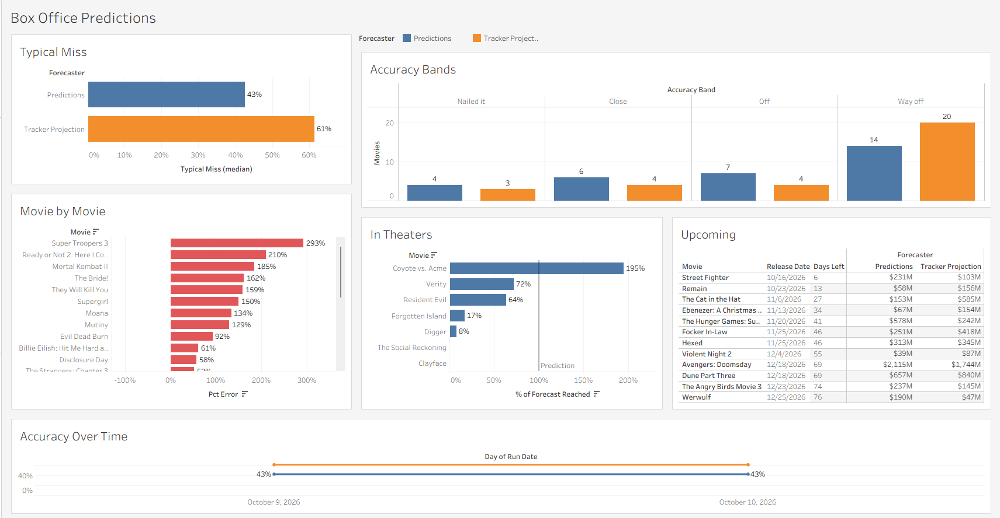
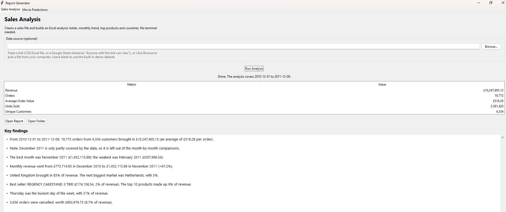
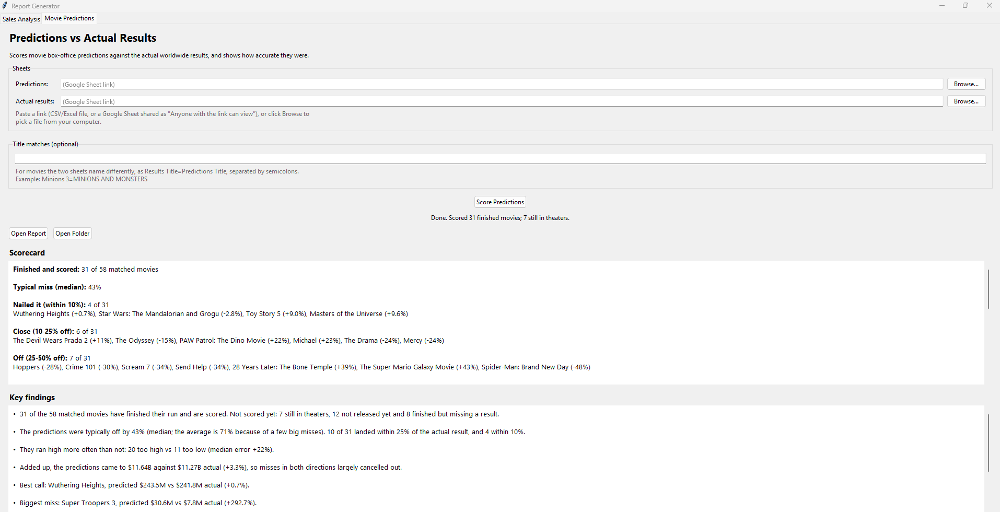

# Retail & Box Office Analytics

[](https://github.com/dumly55/Retail-Box-Office-Analytics/actions/workflows/prediction-report.yml)

Two data projects I put together: a box office tracker that grades movie predictions against what the movies actually made, updated every Monday on its own, and a deep dive into a year of messy online retail sales.

I first built the sales analysis just to see how I could take a messy sales report and sort it into something easy to read. The movie predictions were the part I was really interested in. Other than reading reviews, I was curious how interested people actually were in a movie. Reading about the hype is one thing, but seeing the actual numbers confirms it.

## Box office prediction tracker

[](https://public.tableau.com/app/profile/miko.tonthat2063/viz/MoviePredictions_17916936258720/BoxOfficePredictions)

**[See the interactive dashboard on Tableau Public](https://public.tableau.com/app/profile/miko.tonthat2063/viz/MoviePredictions_17916936258720/BoxOfficePredictions)**

One sheet holds worldwide box office predictions for this year's movies. Another tracks what they actually earn. Every Monday, a scheduled job reads both sheets, matches the movies up, scores every prediction, saves the results to a small SQLite database, and builds an Excel report. The Tableau dashboard is built from that history.

So far (October 2026), 31 movies have finished their run. The predictions were typically off by **43%**. The box office tracker's own projections were off by **61%**.

```
Predictions sheet ─┐
                   ├─► match titles, check each movie's status, score ─► Excel report
Results sheet ─────┘          │
                              └─► SQLite history ─► SQL queries ─► Tableau
```

A few things that made it more interesting than it sounds:

- **Movies still in theaters aren't scored yet.** Their numbers are still climbing, so judging a full-run prediction against them would be unfair. The dashboard shows how far along each one is instead. Coyote vs. Acme passed its prediction while still in theaters.
- **The two sheets don't spell titles the same way.** Emojis, punctuation and small spelling differences ("Coyote v. Acme" vs "Coyote vs. Acme") are matched up, but never two titles with different numbers, so Toy Story 4 can't get mixed up with Toy Story 5.
- **The results sheet flickers.** It pulls numbers live from a website, and some cells come back blank on one download and filled on the next. Each run downloads it three times and keeps every number it sees, then falls back on the saved history for anything still missing.

### The SQL side

Every Monday's scores are saved to SQLite, and these queries in [`sql/`](sql/) dig into them:

- How accurate is each forecaster, and what's the typical (median) miss?
- How many movies landed in each accuracy band, from "nailed it" to "way off"?
- Movie by movie, which forecaster came closer?
- Were predictions better in some release months than others?
- What were each forecaster's five biggest misses?
- Is accuracy getting better from week to week?
- How much of its prediction has each in-theater movie earned so far?

SQLite has no median function, so the median query builds one with window functions.

## Retail sales analysis

This one started with the [UCI "Online Retail" dataset](https://archive.ics.uci.edu/dataset/352/online+retail): every line of every invoice from a UK online shop, December 2010 to December 2011. It's real data and it's messy, so most of the work was cleaning it up before trusting any number.

| | Rows |
|---|--:|
| Raw rows | 541,909 |
| Exact duplicates | −5,268 |
| Cancelled orders (set aside and analyzed separately) | −9,251 |
| Postage, fees and other lines that aren't products | −2,318 |
| Zero or negative prices and quantities | −2,501 |
| **Clean sales rows** | **522,571** |

Postage was a sneaky one. Before it was filtered out, "DOTCOM POSTAGE" was the shop's best-selling "product" of the whole year.

### What the year looked like

```
       Sales Analysis - 2010-12-01 to 2011-12-09
┌─────────────────────┬────────────────┐
│ Metric              │          Value │
├─────────────────────┼────────────────┤
│ Revenue             │ £10,247,905.13 │
│ Orders              │         19,773 │
│ Average Order Value │        £518.28 │
│ Units Sold          │      5,561,420 │
│ Unique Customers    │          4,334 │
└─────────────────────┴────────────────┘
```

- Sales nearly doubled heading into the holidays: £775,715 in December 2010, £1,452,116 in November 2011. February was the slowest month.
- The UK made up 85% of revenue. The next biggest market, the Netherlands, was 3%.
- No single product dominated. The best seller, a three-tier cake stand, was 2% of revenue, and the top 10 products together were 9%.
- Thursday was the busiest day of the week.
- 3,836 orders were cancelled, worth £893,980, almost 9% of revenue.

Everything ends up in an Excel workbook with a summary and monthly chart, top products, a country breakdown, the cleaned data, and a log of every row that was removed and why.

The same cleanup works on other sales spreadsheets too. It recognizes common column names like "Order Date" or "Qty", skips title rows above the header, and reads amounts like `$1,200.00`.

## Try it yourself

```bash
python -m venv .venv
.venv\Scripts\activate          # macOS/Linux: source .venv/bin/activate
pip install -r requirements.txt

python -m src.sales_analysis                                                # retail analysis (downloads the dataset the first time)
python -m src.sales_analysis --data-file my_sales.xlsx                      # or run it on your own sales file
python -m src.prediction_report --predictions "<link>" --actuals "<link>"   # box office report
```

Prefer clicking? `run_gui.bat` opens a small desktop app with a tab for each project.

| Sales Analysis | Movie Predictions |
|---|---|
|  |  |

The weekly box office run is a GitHub Actions workflow ([`prediction-report.yml`](.github/workflows/prediction-report.yml)). It runs every Monday at 06:30 UTC and saves the updated history back to this repo.

## What I learned

- **Clean data before you trust any number.** Postage was hiding in the sales data as a "product", and it would've been the best seller of the year. One filter changed the whole story.
- **Averages can lie.** A couple of huge misses made the average error look way worse than it really was. The median gave a much fairer picture of how close the predictions usually were.
- **Being fair matters as much as the math.** Scoring a movie that's still in theaters against a full-run prediction makes the prediction look bad for no reason, so those wait until their run is over.
- **Real data sources are unreliable.** The results sheet would randomly come back with blank cells, so I had to download it a few times and keep a history to fill in the gaps.
- **SQL can do more than I expected.** SQLite doesn't have a median function, so I learned to build one with window functions. That's when ROW_NUMBER and PARTITION BY finally clicked for me.
- **Tableau was a learning curve.** My first dashboard was every chart crammed into one column. Getting it to look clean took more tries than building the charts did.
